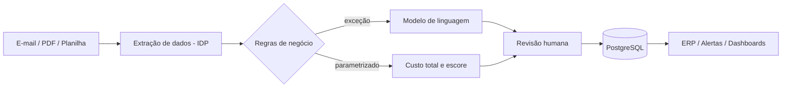
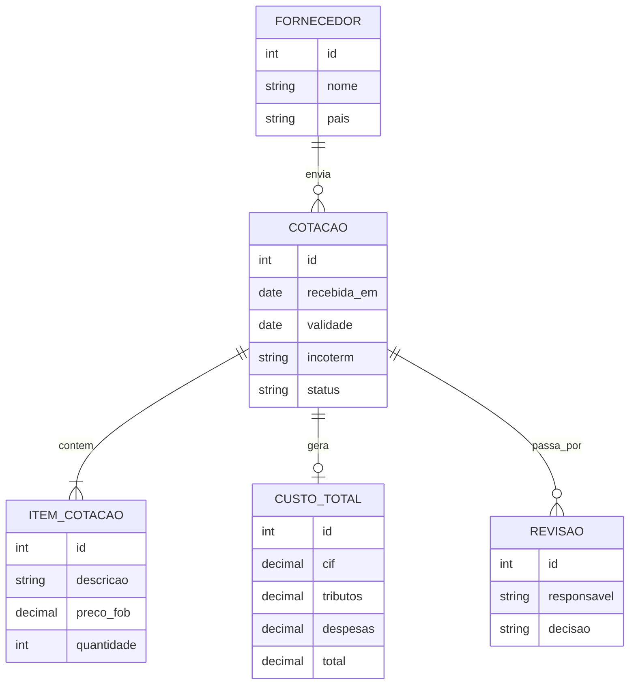

# Arquitetura

Estado: **proposta de arquitetura**. Os componentes abaixo estão planejados e ainda não foram implementados; apenas a página e o simulador existem.

## Fluxo



## Componentes planejados

| Componente | Função |
|---|---|
| Servidor Linux (VPS) | Hospedagem auto-hospedada |
| Docker e Docker Compose | Execução dos serviços em contêineres |
| n8n | Orquestração dos fluxos (gatilho de e-mail, etapas e notificações) |
| PostgreSQL | Persistência de cotações, fornecedores e decisões |
| Modelo de linguagem | Tratamento das exceções da triagem |

## Modelo de dados (proposta)



## Decisões técnicas

- **Regras antes da IA:** o que já está parametrizado é resolvido por regra; o modelo de linguagem só trata exceções. Reduz custo e torna o comportamento previsível.
- **Humano no circuito:** a aprovação final fica com uma pessoa, seguindo o desenho de automação em quatro etapas descrito por Jeong et al. (2025).
- **Custo total, não preço:** a comparação usa o custo desembarcado, pois ele costuma ser subestimado (Pumpe e Vallée, 2017).
- **Escore multicritério:** os pesos partem dos critérios de maior importância em Ali, Nipu e Khan (2023) e são adaptados à empresa parceira.
- **Site estático:** a página e a demo rodam só no navegador, sem servidor, para publicação no GitHub Pages.

## Cálculo usado na demonstração

```
CIF      = FOB + frete + seguro
Tributos = CIF x alíquota + despesas por embarque
Total    = CIF + Tributos
```

Simplificação didática (alíquota única). O cálculo oficial depende de classificação fiscal, regime e legislação vigente.
