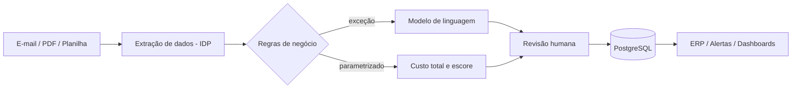
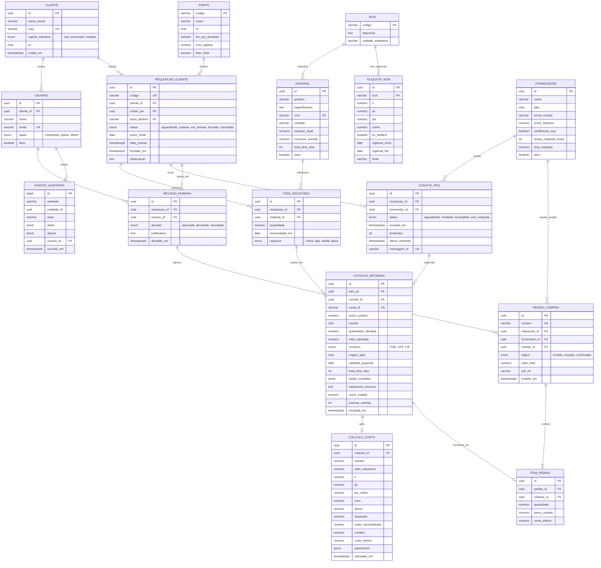

# Arquitetura

Estado: **proposta de arquitetura**. O recebimento de cotações por e-mail já está implementado, assim como o simulador de demonstração; os demais componentes estão planejados.

## Fluxo



## Componentes planejados

| Componente | Função |
|---|---|
| Servidor Linux (VPS) | Hospedagem auto-hospedada |
| Docker e Docker Compose | Execução dos serviços em contêineres |
| n8n | Orquestração dos fluxos (gatilho de e-mail, etapas e notificações) |
| PostgreSQL | Persistência de cotações, fornecedores e decisões |
| Modelo de linguagem | Tratamento das exceções da triagem |

## Modelo de dados (proposta)

Banco relacional (PostgreSQL, administrado pelo NocoDB). Os tipos abaixo são os planejados; valores monetários usam `numeric(14,2)`, alíquotas `numeric(6,3)` e quantidades `numeric(14,3)`.



### Restrições e índices

- **Trava de duplicidade:** `COTACAO_RECEBIDA.email_id` é único, e o n8n só processa um e-mail se o identificador ainda não existir.
- **Uma cotação por convite e item:** índice único em (`convite_id`, `item_id`).
- **Integridade:** chaves estrangeiras com `ON DELETE RESTRICT` nas tabelas de negócio. Nada que já foi cotado ou aprovado é apagado.
- **Vigência de alíquotas:** `ALIQUOTA_NCM` guarda histórico por período; o cálculo usa a vigência da data da cotação.
- **Rastreabilidade:** `CALCULO_CUSTO.parametros` (jsonb) congela câmbio, alíquotas, regime e cenário usados, para que o número possa ser reproduzido depois. Toda mudança de status gera um registro em `EVENTO_AUDITORIA`.
- **Índices de consulta:** `REQUISICAO_CLIENTE(status, prazo_limite)`, `CONVITE_RFQ(status, enviado_em)` para o follow-up e `MATERIAL(ncm)`.

### Campos derivados

| Campo | Regra |
|---|---|
| `MATERIAL` cobertura (dias) | `estoque_atual / consumo_mensal x 30` |
| `ITEM_SOLICITADO.urgencia` | margem = cobertura − `lead_time_dias`; crítica se margem ≤ 0, alta se ≤ 10, média se ≤ 30, baixa acima disso |
| `FORNECEDOR.taxa_resposta` | cotações respondidas / convites enviados |
| `COTACAO_RECEBIDA.score_rodada` | média ponderada: custo efetivo por tonelada 40%, lead time 20%, histórico 20%, ESG 20% (pesos configuráveis) |

## Decisões técnicas

- **Regras antes da IA:** o que já está parametrizado é resolvido por regra; o modelo de linguagem só trata exceções. Reduz custo e torna o comportamento previsível.
- **Humano no circuito:** a aprovação final fica com uma pessoa, seguindo o desenho de automação em quatro etapas descrito por Jeong et al. (2025).
- **Custo total, não preço:** a comparação usa o custo desembarcado, pois ele costuma ser subestimado (Pumpe e Vallée, 2017).
- **Escore multicritério:** os pesos partem dos critérios de maior importância em Ali, Nipu e Khan (2023) e são adaptados à empresa parceira.
- **Site estático:** a página e a demo rodam só no navegador, sem servidor, para publicação no GitHub Pages.

## Cálculo usado na demonstração

```
CIF      = FOB + frete + seguro
Tributos = CIF x alíquota + despesas por embarque
Total    = CIF + Tributos
```

Simplificação didática (alíquota única). O cálculo oficial depende de classificação fiscal, regime e legislação vigente.
